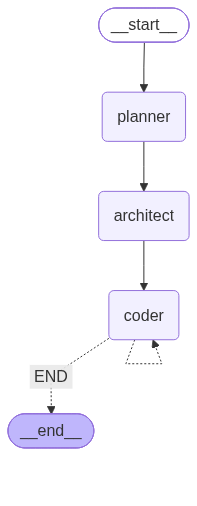
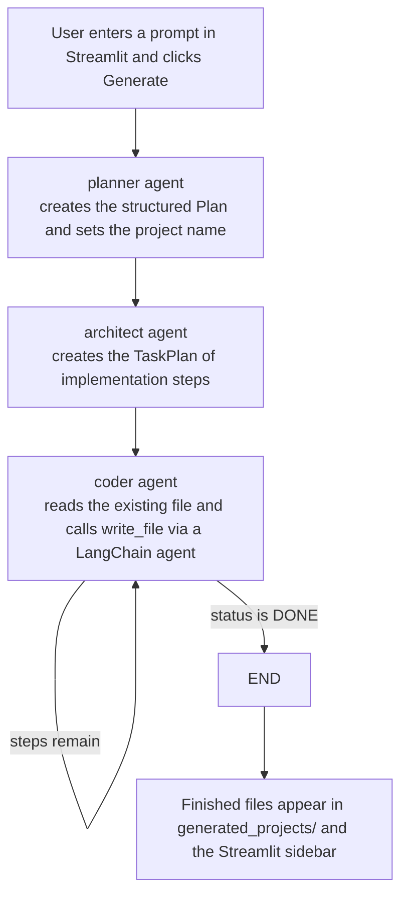

# Coder Buddy

A LangGraph multi-agent AI app builder with a Streamlit UI.


Coder Buddy turns a one-line description of an app into working code. Describe what you want to build, and three LLM agents — a planner, an architect, and a coder — work together to plan, break down, and write out the project file by file.

## Features

- Plan an app from a single natural-language prompt
- Automatic breakdown of the plan into ordered implementation steps
- Step-by-step code generation with awareness of previously written files
- Generated projects saved locally and browsable from the Streamlit sidebar
- Runs against any OpenAI-compatible model via OpenRouter

## Architecture





The graph lives in [agent/graph.py](agent/graph.py). `planner` and `architect` call the LLM once each with structured output (`Plan` and `TaskPlan` from [agent/states.py](agent/states.py)). `coder` runs in a loop: for each implementation step it reads the current file content, hands it to a LangChain tool-calling agent with the file tools from [agent/tools.py](agent/tools.py), and advances to the next step. A conditional edge sends `coder` back to itself while steps remain, and to `END` once `status` is `DONE`.

## Project Structure

| Path | Description |
| --- | --- |
| [main.py](main.py) | Streamlit app: prompt input, streams the graph, renders per-node logs, sidebar project browser |
| [agent/graph.py](agent/graph.py) | The LangGraph `StateGraph` wiring the planner, architect and coder nodes |
| [agent/states.py](agent/states.py) | Pydantic models: `Plan`, `ImplementationTask`, `TaskPlan`, `CoderState` |
| [agent/prompts.py](agent/prompts.py) | Prompt templates for the planner, architect and coder agents |
| [agent/tools.py](agent/tools.py) | File tools (`write_file`, `read_file`, `list_files`, `get_current_directory`, `run_cmd`) scoped to a project root, plus the safe-path check |
| [generated_projects/](generated_projects/) | Output folder — each build creates a subfolder here with the generated app's files (not committed to git) |

## Getting Started

```bash
git clone <this-repo-url>
cd coder-buddy

# Option A: using uv
uv sync

# Option B: using venv + pip
python -m venv .venv
source .venv/bin/activate
pip install -r requirements.txt

# Add your API key
cp .env.example .env
# then edit .env and set OPENROUTER_API_KEY

streamlit run main.py
```

## Environment Variables

| Variable | Description |
| --- | --- |
| `OPENROUTER_API_KEY` | API key for [OpenRouter](https://openrouter.ai), used to call the LLM for all three agents |

> **Note:** OpenRouter is a paid, credit-based service. A single build can trigger many LLM calls (one per planner/architect step, plus one per file the coder writes), so it can use a meaningful amount of credit. Keep an eye on your account balance before running large builds.

## Example Prompts

- "A to-do list app with add, complete, and delete, in HTML, CSS and JavaScript"
- "A simple calculator in HTML, CSS and JavaScript"
- "A personal expense tracker web page with a form and a running total"

## Safety Notes

- **`run_cmd` runs real shell commands.** [agent/tools.py](agent/tools.py) defines a `run_cmd` tool that executes arbitrary shell commands inside the generated project folder. Only run this app on a machine you trust, and never expose it on a public or shared network — an untrusted prompt could be used to run unwanted commands.
- **Review generated code before running or deploying it.** The coder agent writes files autonomously based on LLM output. Treat generated code the same as any other code from an untrusted source: read it before you execute it, install its dependencies, or deploy it anywhere.
- Never commit your `.env` file or real API keys. Use `.env.example` as the template and keep secrets local.
